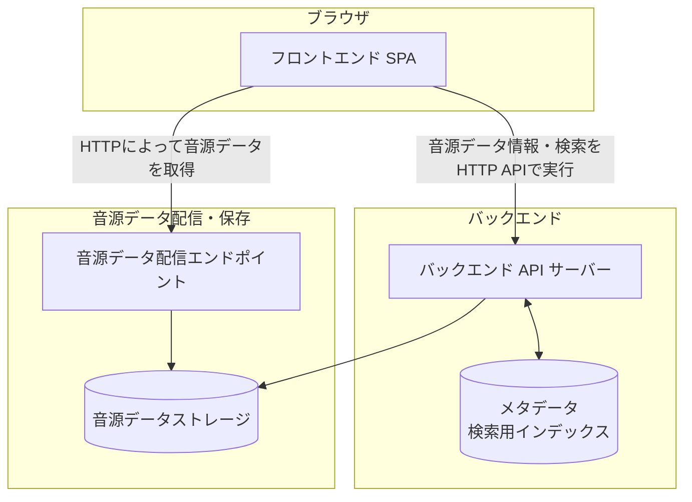

# ドキュメントのスコープ
本ドキュメントは、以下をスコープとする。

* システム全体のアーキテクチャ設計
* それぞれの成果物の責務

# アーキテクチャ設計の方針
このシステムのアーキテクチャは以下の方針で設計する。

* 特定のインフラ専用とならないような設計を行う
  * あくまでも専用としないことが重要であり、オプションとして特定のインフラに依存した設計を行うことは否定しない
* 音源データが大規模になってもスケールするような設計を行う
* 音源データのポータビリティを第一に考える

# 設計
## システム構成

本システムは大まかには以下のような構成要素からなる。

この中で本リポジトリにおける成果物は、フロントエンドSPA・バックエンドAPIサーバーアプリケーションのみとする。

つまり、音源データストレージの具体実装、HTTPサーバー、メタデータ検索用インデックスDBの具体的なインフラについては取り扱わない。
この設計によって、メタデータ検索用インデックスDBとしてインメモリ・RDB・NoSQLなど、音源データストレージとしてファイルシステム・オブジェクトストレージ・RDBなど、コンテンツ配信にCDNを活用するかどうかなど、インフラの選択肢を広く持つことができる。

## 各構成要素の責務
### フロントエンドSPA
バックエンドAPIサーバーから音源データ情報や検索結果を取得し、音源データ配信エンドポイントから音源データを取得して再生する。

### バックエンドAPIサーバー
音源データ情報及び検索機能をHTTP APIとして提供する。

### メタデータ及び検索用インデックス
音源データから導出した、検索やキャッシュに利用する情報を保持する。
ここに保持する情報は派生情報とし、音源データから再構築できなければならない。

### 音源データストレージ
音源データを、それぞれの具体実装に応じた保存表現で保持する。
ただし、具体的な保存表現の違いを隠蔽し、保存時と同一のバイト列としてポータブルに取得できるようにする。
具体的な保存基盤は本リポジトリのスコープとしない。

### 音源データ配信エンドポイント
音源データをHTTPによってフロントエンドSPAへ配信する。
HTTPサーバー、オブジェクトストレージ、CDNなどの具体的な構成は本リポジトリのスコープとしない。
