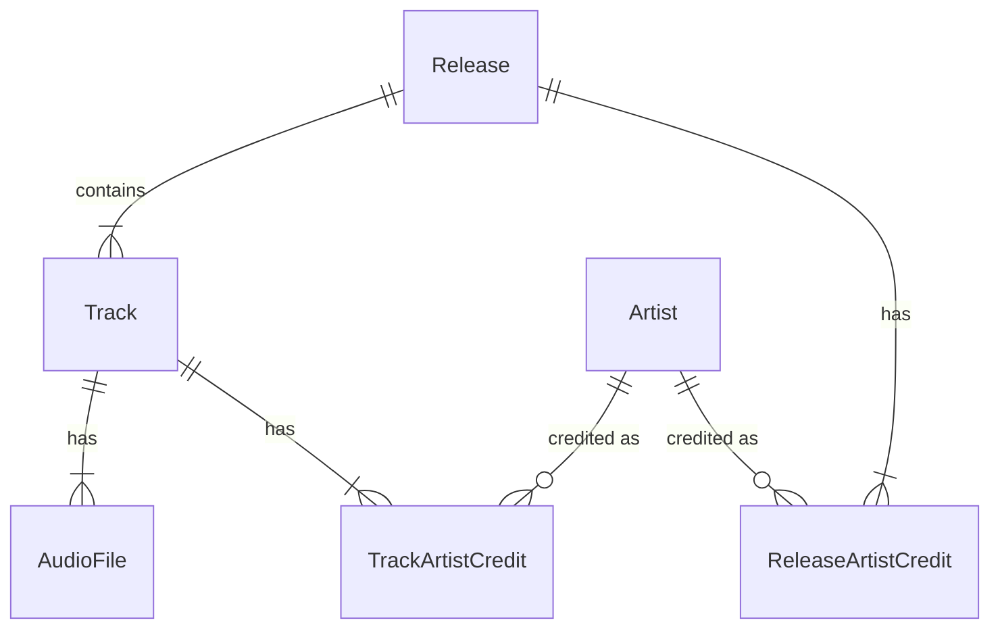

# ドキュメントのスコープ
本ドキュメントは以下をスコープとする。

- ドメインモデル
- オリジナル音源に関するルール
- エンティティの識別子

なお、実際の音源データファイルに関する事項については本ドキュメントのスコープ外であり、[music_data.md](./music_data.md)にて定義する。
音源データの取り込みと検証も同ドキュメントのスコープとする。

# ドメインモデル
## 各エンティティの定義
### Release
アルバムやシングルといったリリース単位のメタデータを保持する。
通常盤や特別盤などの版の違いは、異なるリリース名として表現する。

| 属性 | 型 | 必須性 | 意味・制約 |
| --- | --- | --- | --- |
| id | 文字列 | 必須 | 下記の識別子生成規則に従う |
| title | 文字列 | 必須 | リリース名 |
| release_date | 文字列 | 必須 | 有効な日付を表す`YYYY`、`YYYY-MM`、`YYYY-MM-DD`のいずれか。月・日は補完せず、月と日は2桁で表す |

### Track
Release内における個々の楽曲単位のメタデータを保持する。
Trackは単一のReleaseのみに所属する。
同じ録音が異なるReleaseに収録されている場合も、それぞれ別のTrackとして扱う。

| 属性 | 型 | 必須性 | 意味・制約 |
| --- | --- | --- | --- |
| id | 文字列 | 必須 | 下記の識別子生成規則に従う |
| album_id | Releaseの識別子 | 必須 | 所属するRelease |
| disc_number | 整数 | 必須 | 正の整数。欠落時に補完しない |
| track_number | 整数 | 必須 | 正の整数。欠落時に補完しない |
| title | 文字列 | 必須 | トラックタイトル |
| duration_ms | 整数 | 必須 | 0以上の再生時間（ミリ秒） |

### AudioFile
Trackに紐づく実際の音源データに関するメタデータを保持する。

| 属性 | 型 | 必須性 | 意味・制約 |
| --- | --- | --- | --- |
| id | UUID | 必須 | 下記のAudioFile識別子の規則に従う |
| track_id | Trackの識別子 | 必須 | 所属するTrack |
| object_key | 文字列 | 必須 | 音源データストレージ上の保存場所を示すキー |
| format | 文字列 | 必須 | 音源フォーマット |
| sample_rate | 整数 | 必須 | 正の整数。サンプルレート（Hz） |
| bit_depth | 整数 | 必須 | 正の整数。ビット深度（bit） |
| channels | 整数 | 必須 | 正の整数。チャンネル数 |
| bitrate | 整数 | 必須 | 正の整数。ビットレート（bit/s） |

### Artist
アルバムや楽曲に関わるアーティストのメタデータを保持する。

| 属性 | 型 | 必須性 | 意味・制約 |
| --- | --- | --- | --- |
| id | 文字列 | 必須 | 下記の識別子生成規則に従う |
| name | 文字列 | 必須 | アーティスト名。MBIDの有無にかかわらず必要 |

### ReleaseArtistCreditとTrackArtistCredit
ReleaseとTrackには、それぞれ1名以上のArtistへのクレジットを持たせる。

| 属性 | 型 | 必須性 | 意味・制約 |
| --- | --- | --- | --- |
| album_idまたはtrack_id | ReleaseまたはTrackの識別子 | 必須 | クレジット対象のエンティティ |
| artist_id | Artistの識別子 | 必須 | クレジットされたArtist |
| position | 整数 | 必須 | クレジットの表示順 |
| join_phrase | 文字列 | 任意 | アーティスト名を連結する句 |

## オリジナル音源と派生音源
各Trackに紐づくオリジナル音源は必ず1つのみとする。
同じTrackに紐づくその他のAudioFileは、帯域に応じた再生音源の切り替えなどに用いる派生音源として扱う。

## ER図



# エンティティの識別子
## AudioFile
AudioFileの識別子は、[RFC 9562](https://datatracker.ietf.org/doc/html/rfc9562)によって定められるUUID v4を用いる。
文字列表現には、16進数を8桁・4桁・4桁・4桁・12桁に区切ったハイフン付きの形式を使用する（例: `2f1c75fc-55de-4d4b-8992-76050f65dff0`）。

識別子は保存時に発行し、再起動やインデックスの再構築時に発行し直さない。
メタデータに基づくRelease・Track・Artistの識別子が変わっても、AudioFileの識別子は維持する。
同定結果の統合によって音源ファイルを削除したり上書きしたりしない。

## AudioFile以外のエンティティ
### 識別子の生成規則
AudioFile以外のエンティティは、音源データ中のメタデータを用いて次の共通手順で識別子を生成する。

1. 下表に従ってメタデータを取得し、正規化する
1. 取得したメタデータを元にハッシュ入力を決定する
   - Artistで有効なMBIDがある場合：`["tonhalle-id-v0", 種別, "mbid", MBID]`
   - それ以外の場合：`["tonhalle-id-v0", 種別, "metadata", メタデータ配列]`
1. `{種別}-{64桁のハッシュ値}`を識別子とする

ReleaseとTrackは、MBIDの有無にかかわらずメタデータ配列から識別子を生成する。

| エンティティ | 種別 | 識別子生成に使用するMBID | メタデータ配列 |
| --- | --- | --- | --- |
| Artist | `artist` | `musicbrainz_albumartistid`と`musicbrainz_artistid`から、それぞれ独立して個々のArtist MBIDを取得する | `[name]` |
| Release | `release` | 使用しない | `[artistIds, title, releaseDate]` |
| Track | `track` | 使用しない | `[releaseId, discNumber, trackNumber, title]` |


なお、Artistに関しては1つの音源データから複数のエンティティを生成する場合がある。


### メタデータの取得と正規化
| 値 | 取得元 | 正規化手順・欠落時の扱い |
| --- | --- | --- |
| ArtistのMBID | — | 共通の文字列正規化を適用し、ハイフン付きUUID形式として検証する。有効な場合は英字を小文字に統一し、任意の情報であり、欠落・不正値は有効なMBIDなしとして扱う |
| `name` | リリースまたはトラックのクレジットに含まれるアーティスト名。明示的な複数値は各値を個別に取得する。単一の文字列でも、同じクレジットの有効なArtist MBID一覧などから人数が分かる場合は、下記の規則で分割する | 各名前に共通の文字列正規化を適用する |
| `artistIds` | リリースにクレジットされたArtistの識別子。トラックにクレジットされたArtistの識別子は含めない | クレジットの表示順に並べた配列とする |
| Releaseの`title` | リリース名 | 共通の文字列正規化を適用する |
| `releaseDate` | リリース日 | Releaseの`release_date`に定義する形式をそのまま使用する |
| `releaseId` | 所属するReleaseの識別子 | 取得した識別子をそのまま使用する |
| `discNumber`、`trackNumber` | ディスク番号、トラック番号 | Trackの属性定義に従う整数を先頭ゼロのない10進数文字列に変換する。`番号/総数`形式は番号のみを使用する |
| Trackの`title` | トラックタイトル | 共通の文字列正規化を適用する |


### アーティストの分割
単一のアーティスト名文字列の分割と、MBIDとの対応には次の規則を適用する。
リリースとトラックのクレジットは、それぞれ独立して扱う。

- 人数が不明、または1人の場合は文字列全体を1つの名前として扱う
- 人数が2人以上の場合は、` feat. `、` feat `、` ft. `、` ft `、` & `、` / `、`; `を分割候補とする。英字の区切りは大文字・小文字を区別しない
- 人数と一致する数の空でない名前へ分割でき、分割方法が一意に決まる場合のみ採用する
- 明示的な複数値の名前は再分割しない
- 名前一覧とMBID一覧の件数が一致する場合は、格納順で対応づける
- 分割できない場合や件数が一致しない場合は、名前を持つArtistとMBIDの対応を確定できず、有効なクレジットとして扱わない

### 共通の文字列正規化
識別子の生成においては以下の規則を適用し正規化を行う

- 前後のASCII空白文字（U+0009からU+000D、およびU+0020）を除去し、UnicodeのNFCで正規化する
- 必須の文字列の欠落、および正規化後に空文字列となる値は無効とする

ただし、この規則はあくまでも識別子生成のみに適用し、それ以外の表示名などには適用しない。

### 共通のハッシュ仕様
ハッシュは、入力となる配列をJSONの文字列表現に変換し、そのUTF-8バイト列を使用し、SHA-256を計算した全32バイトを小文字の16進数64桁に変換することで得る。

JSONの文字列表現には、次の規則を適用する。

- 配列の要素順と入れ子構造を維持する
- 文字列外に空白・改行を挿入せず、末尾の改行とBOMも付与しない
- 文字列内の二重引用符とバックスラッシュは、それぞれ`\"`と`\\`でエスケープする
- 制御文字のうちU+0008、U+0009、U+000A、U+000C、U+000Dは、それぞれ`\b`、`\t`、`\n`、`\f`、`\r`で表す
- その他のU+0000からU+001Fは、小文字の16進数4桁を用いた`\u00xx`で表す
- その他の文字はUnicodeエスケープせずUTF-8で表し、スラッシュもエスケープしない

例えば、Releaseのメタデータに基づくハッシュ入力は次の形式となる。

```json
["tonhalle-id-v0","release","metadata",[["artist-aaaaaaaaaaaaaaaaaaaaaaaaaaaaaaaaaaaaaaaaaaaaaaaaaaaaaaaaaaaaaaaa"],"Example Album","2026"]]
```
