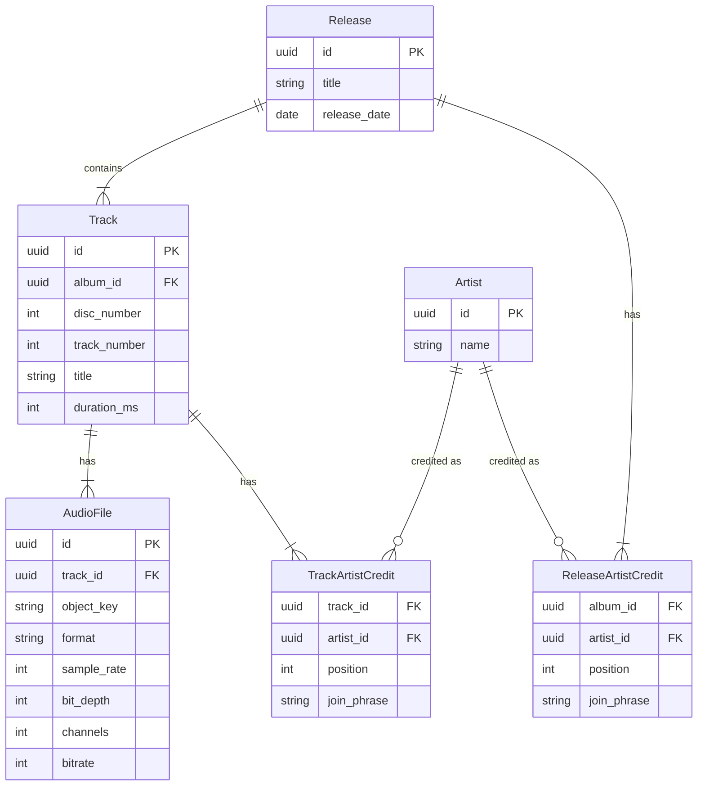

# ドキュメントのスコープ
本ドキュメントは以下をスコープとする。

- ドメインモデル

なお、実際の音源データファイルに関する事項については本ドキュメントのスコープ外であり、[mudic_data](./music_data.md)にて定義する。

# ドメインモデル
## 各エンティティの定義

- Release: アルバムやシングルといったリリース単位のメタデータを保持する
- Track: Release内における個々の楽曲単位のメタデータを保持する
- AudioFile: Trackに紐づく実際の音源データに関するメタデータを保持する
- Artist: アルバムや楽曲に関わるアーティストのメタデータを保持する

## ER図

